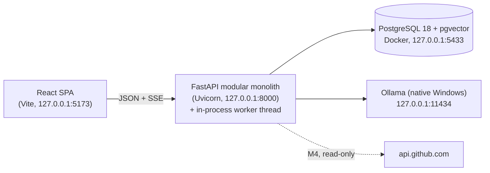
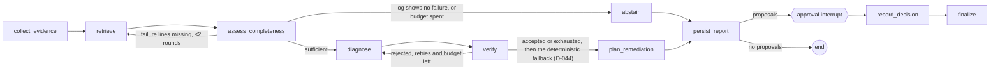
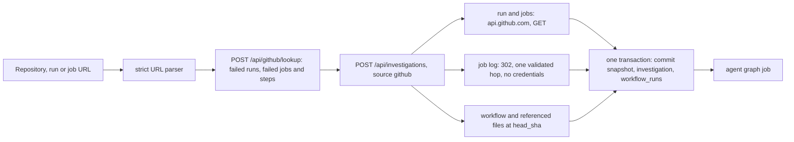
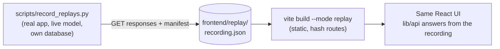

# Architecture

> **Status:** M1 (functional MVP) is built. Sections marked *(planned, Mx)* describe the approved design and are not built yet. Decisions and their rationale are in `DECISIONS.md`.

## System overview



- **Only PostgreSQL runs in Docker.** The backend and frontend run natively in development, so Ollama never needs to listen beyond loopback. For demos, M6 built a static replay of recorded runs instead of the planned mock-provider Compose profile (D-048; see "Replay build and languages").
- **One backend process** hosts the API and the background worker thread (D-019).

| Module (`backend/src/kensa/`) | Responsibility |
|---|---|
| `api` | Routes, request/response schemas, SSE stream, body-size limit, workspace dependency |
| `core` | Settings (loopback-only Ollama URL), JSON logging |
| `db` | SQLAlchemy models, sync engine (D-015), health probe; Alembic migrations in `backend/alembic` |
| `ingestion` | Normalisation and limits, line-preserving secret redaction, CI-log-aware chunking; YAML, Markdown and code chunkers (M2) |
| `analysis` | Error-signature rules, rule classifier, the 8 failure categories |
| `indexing` | Repositories, scoped documents, incremental re-indexing, knowledge notes, pending embeddings (M2) |
| `retrieval` | Signature, full-text and vector channels, weighted RRF fusion, scope, tail fallback |
| `inference` | `InferenceProvider` seam: `MockProvider` (rules only), `OllamaProvider` (httpx, D-017); embedders (Ollama, hashing) |
| `agents` | Pipeline nodes, prompt construction, verifier, fix templates, job handler |
| `jobs` | Leased PostgreSQL job queue and worker |
| `investigations` | Create and retry services, bundled samples |
| `github` (M4) | Read-only GitHub client (`client.py`), URL and redirect rules (`urls.py`), public-address-only transport (`net.py`), run import (`importer.py`) |
| `evaluation` | Frozen-dataset loading and verification, retrieval metrics (M2) |

## Request flow (built in M1)

1. **Create:** the UI posts a pasted log, an uploaded file read as text in the browser, or a sample ID. In one transaction the API:
   - rejects oversized bodies (413) before parsing
   - normalises the log (ANSI and control characters, size and line limits)
   - **redacts secrets** without moving line numbers
   - extracts error signatures, classifies them with rules, chunks the log
   - stores the investigation, document, chunks and signatures
   - enqueues a job keyed `investigate:<id>:1`
2. **Run:** the worker claims the job under a lease and runs the pipeline nodes. Each node appends an `agent_event`, and every write is fenced by the lease.
3. **Watch:** the UI loads the timeline over REST, then follows `GET /api/investigations/{id}/stream` (SSE: `agent_event`, `status`, `end`; resumable via `Last-Event-ID`). It renders the report. Each valid citation links to the highlighted log line or, for repository, documentation or knowledge evidence, to that evidence card.

## Background jobs (built in M1)

Jobs live in a PostgreSQL `jobs` table processed by a worker thread. There is no Redis or Celery. Jobs run one at a time.

- **Claim:** `FOR UPDATE SKIP LOCKED` picks a job that is queued and due, or one whose lease has expired (and has attempts left). The claim sets `lease_owner` and `lease_expires_at` and increments `attempts`, which doubles as the fencing token.
- **Heartbeat:** extends the lease. Expired leases are reclaimed by any worker. Jobs that expire on their final attempt are reaped as `dead`, reported as `worker_lost`.
- **Retries:** exponential backoff with jitter up to `max_attempts` (3). Typed errors decide whether a failure is retryable: for example, model unavailable and timeouts retry, while a missing model is permanent.
- **Duplicate protection:**
  - a unique `idempotency_key`
  - a partial unique index allowing one active job per investigation
  - fencing: every handler write first runs `assert_lease` (`SELECT … FOR UPDATE` on the job row with the current owner and attempt)
  - the report step *replaces* earlier evidence and diagnoses, so a re-run after a crash never duplicates them
- **Outcome listener:** turns a retry into status `queued` with a timeline note, and a final failure into status `failed` with a user-facing message.
- **M3:** jobs drive the agent graph. A retry resumes from the last checkpoint instead of starting over, and a `resume` job continues a run past the approval interrupt.

## Inference

```
InferenceProvider
  generate_structured(request) -> StructuredResult (validated Pydantic value + tokens, timing)
Embedder (M2)
  embed_documents(texts) / embed_query(text) -> L2-normalised vectors (1024 dimensions)
```

- **`OllamaProvider`:** `/api/chat` with a JSON-schema `format`, `temperature 0`, a fixed seed, and the D-009 options on every request (`num_gpu=99`, `num_ctx=8192`).
  - Schema failures get one repair turn. A second failure raises `MalformedOutputError`, and the pipeline then completes with status "unknown".
  - Errors are typed: `ModelUnavailable` (retryable), `InferenceTimeout` (retryable), `ModelMissing` (permanent), `MalformedOutput` (permanent).
- **Embedders (M2, D-024):**
  - `OllamaEmbedder` calls `qwen3-embedding:0.6b` through `/api/embed`. Queries get a task instruction prefix; documents are embedded as is.
  - `HashingEmbedder` is a deterministic feature-hashing stand-in for tests and CI.
  - On this 4 GB GPU the embedder and the LLM cannot be resident together. Embeddings use the GPU (41 vs 0.8 chunks/s on the CPU, measured), so the pipeline embeds first and diagnoses second, and Ollama swaps the models.
  - If embeddings are unavailable, the `index` step degrades to signature and full-text retrieval and says so on the timeline.
- **`MockProvider`:** returns the deterministic rules-only draft, labelled as "Rules only" in the UI. CI and the end-to-end tests use it.
- **Prompt:**
  - a system prompt with the rules and per-field output guidance (D-021)
  - evidence in `<evidence id="E1" …>` blocks with numbered lines, where log text cannot close or forge a block
  - the rule classification, presented as a hint rather than a fact
  - an evidence budget derived from `num_ctx`

## Retrieval (M1; extended in M2)

- **Chunkers:**
  - logs: GitHub `##[group]` steps in windows of up to 60 lines, plus merged error windows around each signature
  - workflow YAML: one chunk per job and per step, with exact line ranges
  - Markdown: one chunk per heading section (headings inside code fences are ignored)
  - code: function and class boundaries for Python, JavaScript/TypeScript, Go and Rust; otherwise 60-line windows
- **Chunk metadata:** document, ordinal, kind, step name, line range, sha256 content hash; a generated `tsv` column (`simple` config) with a GIN index; `embedding vector(1024)` with an HNSW cosine index, plus the name of the model that produced it.
- **Indexing (D-022):**
  - Documents have one identity per scope: an investigation's log by content hash, a repository file by path, and a workspace knowledge note or incident by name.
  - Re-indexing is incremental: unchanged files are skipped, changed files are re-chunked in place, and vanished files are removed.
  - Knowledge notes come from `knowledge/`. Verified investigations are indexed as `incident/<id>` (D-026).
  - Chunks without an embedding from the current model are embedded in the pipeline's `index` step.
- **Scope:** the investigation's own logs, its repository's files, the workspace's knowledge notes, and other investigations' incidents (never its own).
- **Channels:**
  1. Signature lookup, ranked by summed rule weight
  2. Full-text search over terms taken from the signatures
  3. Vector search (M2): HNSW cosine over a query built from the title, the signatures and the end of the log (iterative scan, `ef_search` 200)
  4. The end of the log, only when the other channels find nothing
- **Fusion:** weighted Reciprocal Rank Fusion (k = 60; signature 1.0, full text 0.8, vector 0.8, tail 0.5), fixed before evaluation and not tuned (D-023). Excerpts that overlap one already chosen from the same document by more than 50% are dropped.
- **Measured (dev split):** see `eval/reports/m2-retrieval-dev-ollama.md`. Hybrid is roughly level with signature + full text overall.

## Verification (D-018)

- **Checks:** every citation's evidence ID, line range and quote are checked against the stored, redacted text. A quote found on another line of the same block is accepted with the line corrected, and the correction is noted.
- **Markdown sources** (knowledge notes, repository docs, incidents) are compared without inline markup (backticks, asterisks), which the model drops when quoting prose. Logs and code are compared as written.
- **Status (M5.1, D-040):** the root-cause status is separate from evidence validity.
  - **Evidence validity:** "N of M citations found on their cited lines".
  - **Root-cause status:** corroborated / plausible / conflicting / not_established (it was verified / supported / contradicted / unknown until M5). Only `corroborated` asserts the cause.
  - **UI:** shows the status, a plain explanation of it and the verifier's notes, not the model's confidence. The confidence is capped by the status and kept for analysis. With `not_established` the UI shows no cause, only the evidence and the rule hint.
- **Risky fixes** (force-push, `curl | sh`, `chmod 777`, skipped tests, disabled verification, echoed secrets) are flagged for review.
- **Claim checks (M3, D-029):**
  - **Grounding:** at least one verified citation must come from the run's own log.
  - **Category support:** a cited line must show the claimed category, by its signature rules or its indicator vocabulary (`analysis/indicators.py`).
  - **Conflict:** a cited log line carrying another category's strong signature, with none for the claimed one, makes the diagnosis conflicting.
  - **Cause check (M5.1, D-041):** `analysis/causes.py` finds, over the whole log, lines that *state* an underlying cause (a variable that must be set, an empty variable in a step's `env:` dump, a refused permission or connection, memory exhaustion, a missing path, a compile error, an assertion mismatch).
    - **Corroborated:** a cited log line states a cause of the claimed kind, the log states no competing cause, and the rules do not point elsewhere.
    - **Conflicting:** the log states a different environmental cause and none of the claimed kind. A test regression is always conflicting against a stated environmental cause.
    - **Plausible:** anything in between, with the reason in the notes.
    - **Not causes:** quoted values and assertion text are data, never the environment.
    - **Test regressions are never corroborated (M5.2, D-046):**
      - An assertion shows that a test failed, not why, and "no competing cause" only means none was *recognised*.
      - On the v2 held-out split, corroborated test regressions were right 14 times and wrong 9; every other category was 60/60 (D-045).
      - A test regression is therefore at most `plausible`, and the deterministic fallback never reports one.
  - **Deterministic first (D-044):** if the model's final answer established no cause or named another one, and Kensa's rule-based diagnosis passes as `corroborated`, the report uses the rule-based diagnosis and says the model's answer was set aside.
  - **Instruction-like lines** (prompt injection) are rejected as citations.
  - A failed check makes the diagnosis "cause not established" and, where a retry could help, asks the model again.
- **Invalid citations are never accepted evidence:** a CHECK constraint (a citation is valid with no reason, or rejected with one), and `persist_report` refuses a corroborated diagnosis that contains a rejected citation.
- **Rule classifier (M5.1):** a stated cause scores like a strong signature. When an environmental cause is stated, failing-test summaries, Docker build wrappers and assertion lines count weakly, and a stated environmental cause wins ties.

## Evaluation (M2)

- **Dataset** (`eval/datasets/v1`, D-025): 40 cases written by a separate LLM author isolated from Kensa's code, never by the system's author, each with a log, 3–6 repository files and labels set at authoring time. The split is 20 dev and 20 test.
  - **Quality gates** (`scripts/freeze_dataset.py`) check shape, split counts and an anti-template rule.
  - **Freezing:** `MANIFEST.sha256` freezes the content, independent of line endings, and the harness refuses to run on a changed dataset.
  - **Test split:** locked behind `--allow-test-split`. It was run once in M5 under a pre-registered protocol and is now spent (D-037, D-039).
- **Dataset v2 (M5.1, D-042):** 60 dev and 60 test cases by a separate LLM author, with the case kinds standard, masked, misleading, lookalike and insufficient.
  - **Selection:** `--dataset v2` chooses it; `--database` gives a run its own evaluation database (the M5 baseline uses `kensa_eval_m5`).
  - **Freezing:** a split can be frozen and evaluated on its own (`MANIFEST.<split>.sha256`) before the whole set is frozen.
  - **Analysis:** `scripts/m51_analysis.py` compares systems across both status vocabularies.
- **Harness** (`scripts/evaluate.py`): each case is indexed into a fresh `kensa_eval` database, with incident indexing off so cases cannot leak into each other.
  - **Retrieval mode:** Recall@5, Recall@10, MRR and hit@k per channel and fused.
  - **Diagnosis mode:** runs each configuration end to end, with either the linear M1/M2 pipeline or the M3 agent graph (`--configs`). It reports accuracy by case kind, verification status, citation validity, fix-keyword hits and LLM latency.
    - Agent configurations also report wrong-but-not-abstaining answers, abstentions, diagnosis attempts, model calls, citation validity across all attempts, proposals and diffs, and wall time.
    - Full-text-only retrieval is always one of the configurations (D-027).
  - **Reports:** written to `eval/reports/` with the git SHA, dataset digest, models and hardware.
  - **M5 configurations** (`--configs m5`): rules only, LLM without retrieval (log tail only), LLM + full text, LLM + hybrid, agent + full text, agent + hybrid. Each run writes local traces to `.telemetry/<report name>/`. `scripts/m5_analysis.py` derives the protocol's metrics (false confidence, grounded but wrong, correct and missed abstentions) and re-checks every accepted citation in the database.

## Observability (M5, D-034)

- **Traces:** OpenTelemetry SDK with FastAPI instrumentation, plus manual spans. The SQLAlchemy instrumentation is installed but inactive: it supports SQLAlchemy < 2.1, and 2.1.6 is installed, so there are no SQL spans (D-034 amendment). The manual spans are:
  - every agent node (`node.<name>`), the whole run (`investigation.run`) and each job (`job.<kind>`)
  - GitHub requests, with the host only
  - embeddings, and model calls (`llm.generate`) with Ollama's load, prompt-evaluation and generation timings and tokens per second
- **Exporter:** a JSON-lines file exporter writes to `.telemetry/` (git-ignored, rotated at 20 MB). There is no network exporter. HTTPX is not instrumented, so signed URLs never reach a span, and spans never hold prompts or log text.
- **Logs:** structlog JSON lines carry `trace_id`, `span_id` and a request ID (`X-Request-ID`, echoed or generated). Job logs also carry `job_id` and `investigation_id`.
- **Tools:** `scripts/trace_summary.py` (span percentiles and the model-call breakdown by task); `scripts/security_scan.py` (secret and signed-URL detectors over stored text and trace files, counts only).

## Agent workflow (M3, D-028 to D-030)



`agents/graph.py` is a LangGraph `StateGraph` over the pipeline's node functions (`agents/pipeline.py`).
- **State** (`agents/state.py`) holds only JSON-like values, so checkpoints never need to rebuild Python classes. The checkpointer runs with LangGraph's strict deserialization allowlist.
- **Checkpoints:** `PostgresSaver` (sync, D-015) writes after every step (`durability="sync"`). The tables live in their own `langgraph` schema, created by Alembic migration 0004 as a frozen copy of the library's migrations; the app never calls `setup()`. A test fails if the installed library has a migration the copy lacks.
- **Fencing:** a `PostgresSaver` subclass re-checks the job lease before every checkpoint write, as all other writes do. A worker that lost its lease cannot advance the thread (tested).
- **Recovery:** a reclaimed job resumes from the last checkpoint and re-runs only the unfinished step (tested by killing a worker mid-diagnosis).
- **Driving the graph** (`run_agent`): one call starts the graph, resumes it after a crash, or continues it past the approval interrupt once a decision exists. Both job kinds (`investigate`, `resume`) use it, so a decision recorded while a crashed job was being recovered is still picked up.
- **Completeness** (`agents/completeness.py`, deterministic):
  - A log with no failure vocabulary at all (no error line, failing exit status or failing test) makes Kensa abstain without asking the model.
  - If the excerpts miss the key failure lines, targeted retrieval adds the smallest log chunk around each one (at most 2 rounds).
  - A truncation marker is noted for the model and in the report.
- **Verifier loop:** a rejected diagnosis is retried with the verifier's own feedback, which never quotes evidence text. An honest "unknown" is accepted, not retried. The loop also stops on an identical reply. The best attempt is reported.
- **Budgets:** per run, 3 diagnosis attempts, 2 targeted retrieval rounds, 4 model calls, and 900 s of wall-clock time before any new model call. All are settings.
- **Remediation** (`agents/remediation.py`, D-030):
  - Proposals come from the accepted diagnosis's fixes, plus at most two minimal file edits from the model.
  - Each edit is checked against the full file: the text must occur exactly once, with no secrets, no instruction-like text and a safe relative path. Kensa then computes the unified diff itself.
  - Nothing is ever applied. Rules-only runs produce "template" proposals with no diff.
- **Human approval:**
  - `persist_report` saves the report and proposals and sets `awaiting_approval` before the interrupt. The approval node has no side effects before `interrupt()`.
  - The decision is recorded by `POST /api/investigations/{id}/decision` in one transaction with its resume job. There is one decision per investigation (unique), and repeating it is a no-op. A different decision returns 409.
  - A re-run of `persist_report` after a crash never overwrites a report that already has a decision.

## GitHub integration (M4, D-031 to D-033)



- **Access:** read-only and pinned to `https://api.github.com`.
  - Anonymous by default. GitHub serves job logs only to signed-in requests, so an optional read-only token (`KENSA_GITHUB_TOKEN`) enables the download; without one, the user pastes the log.
  - The GitHub CLI token and any token with OAuth scopes are refused.
- **Lookup:** a repository URL lists recent failed runs; a run or job URL returns the run's failed jobs with their failed steps (from GitHub's step conclusions).
- **Import:** synchronous at creation. The network part runs first, then one database transaction stores:
  - the repository snapshot at the run's commit and its files
  - the investigation, with the log redacted, chunked and signature-scanned as usual
  - a `workflow_runs` record
  - a `github` timeline event
  The agent graph then runs unchanged.
- **Log redirect:** one manual hop to an allowlisted log store over HTTPS on port 443, through a fresh client with no `Authorization` and no cookies. A connection to any non-public address is refused when connecting. Downloads are size- and time-capped, and archives are refused. Signed URLs are never logged or stored.
- **Commit pinning:** retrieval for a GitHub investigation is scoped to its commit snapshot. Evidence from repository files carries `commit_sha` and a GitHub link to the cited lines at that commit.
- **Limits:**
  - API JSON up to 3 MB, logs up to 16 MB downloaded (the last 2 MB stored).
  - Up to 6 referenced files of at most 200 KB each, plus the workflow file.
  - 20 s timeouts, with deadlines on whole reads.

## Replay build and languages (M6, D-047, D-048)
- **Languages:**
  - Every UI string lives in `frontend/src/i18n/en.ts`. `ja.ts` must have the same keys: the type `Messages` makes a missing key a build error, and a test checks the placeholders.
  - Components read the active language through `useStrings()`. The choice persists in the browser and sets `<html lang>`.
  - Model output, evidence and verifier notes are data, so they stay in English, with a note in Japanese.
- **Replay build** (`npm run build:replay`, Vite mode `replay`):
  - **Data:** `scripts/record_replays.py` runs the real app in its production settings against its own database, and saves the API's responses to `frontend/replay/recording.json`. It refuses to write anything that matches the secret, signed-URL or local-path checks.
  - **Answers:** in the replay build, `lib/api/client.ts` answers from that file instead of HTTP (`lib/api/replay.ts`). A decision changes an in-memory copy by the backend's rules, and everything else is refused.
  - **Hosting:** static, with hash routing and no proxy. A banner, a badge and the status pill say it is a replay.
  - **Separation:** the recording ships only in this build. The normal build contains the small adapter as an unused chunk.



## Data model

| Area | Tables |
|---|---|
| Tenancy | `workspaces`; every other row carries `workspace_id` |
| Sources | `repositories` (M2; M4 adds `commit_sha`: one snapshot per GitHub commit), `documents` (one partial unique index per scope, D-022), `chunks` (generated `tsv` + GIN; `embedding vector(1024)` + HNSW), `error_signatures` |
| Investigations | `investigations` (status adds `awaiting_approval`), `evidence`, `diagnoses` (M3 adds `evidence_complete`, `diagnosis_attempts`), `citations` (valid/reason CHECK), `agent_events` (unique per-investigation `seq`) |
| Approval (M3) | `remediation_proposals` (proposed/approved/rejected; M5 adds `withdrawn` with a required reason and time, D-036; diff computed by Kensa), `approval_decisions` (one per investigation) |
| Runtime | `jobs` (partial unique index: one active job per investigation); LangGraph checkpoints in the `langgraph` schema (M3) |
| GitHub (M4) | `workflow_runs`: the run, attempt, job, failed steps, log source, fetched and missing files of an imported investigation |
| Not adopted | A separate `hypotheses` table: the verifier loop keeps its attempts in the graph state. |

Evaluation results are files (`eval/reports/`), not tables: the harness runs in its own `kensa_eval` database, so the planned `eval_*` tables were not needed.

A test asserts that the ORM models and the migration history describe the same schema.

## Security boundaries

The short version is below. `SECURITY.md` holds the principles and the threat model (M5); `eval/reports/m5-security-audit.md` holds the audit findings.

- **Network:** every service binds to 127.0.0.1. CORS allows only the dev UI origin. Request bodies over 2.5 MB are rejected before parsing.
- **The operator's browser (M5, D-035):** only `Host: 127.0.0.1` or `localhost` is accepted (against DNS rebinding), and every state-changing request must be `application/json` (against cross-site requests).
- **Workspace scoping:** every query goes through the workspace dependency. Another workspace's investigation returns 404 on every endpoint (tested).
- **Untrusted inputs:** logs, retrieved text and model output are untrusted. Secrets are redacted before storage and inference (tested with a corpus). The model has no tools and cannot write. Prompt injection inside a log is contained by the evidence delimiters and caught by the verifier (tested).
- **Remediation** is proposals only: text, plus diffs that Kensa computes from validated edits. An approval records a decision; nothing from logs or the model is ever executed or applied.
- **Outbound network (M4):** only GETs to `api.github.com`, plus one validated redirect hop to an allowlisted log store. Every connection is refused if the host resolves to a non-public address. Nothing downloaded is executed, and nothing is written to GitHub (tested statically and with mocks).
