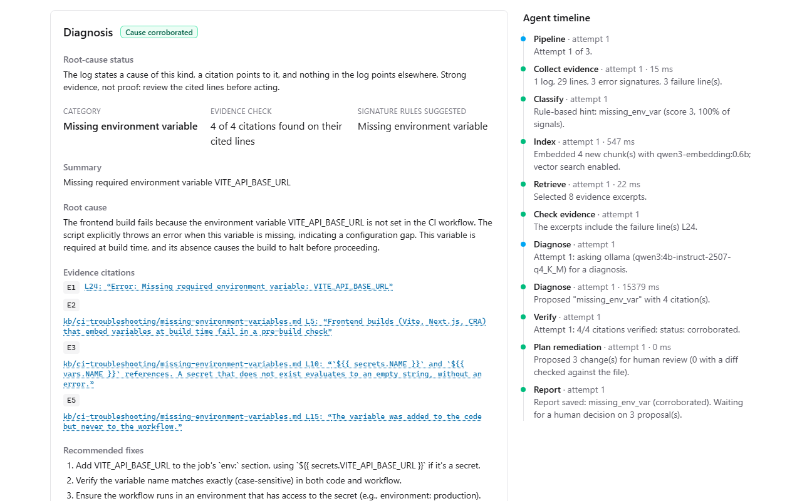
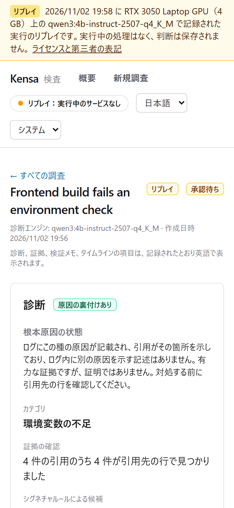
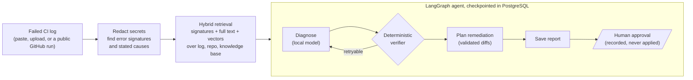

# Kensa (検査)

**Kensa investigates failed GitHub Actions runs on your own machine.** It reads the log, gathers
evidence from the log, the repository and a knowledge base, and gives a root-cause diagnosis in
which every claim cites an exact line. A deterministic verifier checks each citation, and checks
separately whether the log actually states the cause. When it cannot tell, Kensa says so instead
of guessing.

It runs on a laptop with a 4 GB GPU, using a local model, and costs nothing to run.

**[Live demo](https://froxily.github.io/kensa/)**: a prerecorded interactive replay in your
browser, not live AI inference · **[Demo video](docs/media/kensa-demo.webm)** (75 s, captioned) ·
**[Source code](https://github.com/froxily/kensa)** · **Docs:** [architecture](ARCHITECTURE.md),
[evaluation](docs/evaluation.md), [testing](docs/testing.md), [security](SECURITY.md)



> **Status:** v1.1.0 is the current release: change-aware investigation and CI failure analytics are available; historical recurrence matching is **experimental and off by default** ([Changelog](CHANGELOG.md), [Roadmap](ROADMAP.md)). [Demo video](docs/media/kensa-demo.webm)
> (75 s, captioned; [transcript](docs/media/kensa-demo-transcript.md)) · 日本語の概要は[下記](#日本語概要).
> This repository is a clean snapshot of a private development history, so commit IDs quoted in
> the docs and reports refer to that history.

## Try it without a backend or a model: the replay demo

**[Open the live demo](https://froxily.github.io/kensa/)** (GitHub Pages). It is a
**prerecorded interactive replay, not live AI inference**: a static build of the real UI, showing
**real runs recorded with the local model** (the three built-in samples and four evaluation
cases). One of them is a synthetic v1.1 case with its earlier runs and changes, so the "Changes
since the last success" panel and the analytics dashboard can be tried; the replay says so on
those pages. No model, backend or database runs behind it. It makes no request outside its own files,
and says on every page that it is a replay. An approval there is kept in the browser tab only and
is labelled as not saved.

The model's output is shown as it was produced, weak parts included. For the test regression,
two of the five proposals would change the test instead of the code, and the one diff that does
fix the code comes with the explanation "No change needed". Kensa shows them as model
suggestions, each with the risk "changing the test instead of the code hides a real regression",
and applies nothing: that is what the human approval step is for.

To build and serve the same replay locally:

```powershell
npm --prefix frontend install
npm --prefix frontend run build:replay
npm --prefix frontend run preview:replay   # http://127.0.0.1:4174
```



## What Kensa does



- **Evidence, not eloquence.**
  - Every claim cites a line, and the verifier rejects any citation that does not quote it exactly.
  - Citation validity is shown on its own: genuine citations alone never make a cause "corroborated".
- **An honest status for the root cause:**

  | Status | When |
  |---|---|
  | `corroborated` | A cited log line states a cause of the claimed kind, and nothing in the log points elsewhere |
  | `plausible` | Consistent with the evidence, but the cause is not confirmed |
  | `conflicting` | The evidence points to a different cause |
  | `not established` | Kensa cannot tell, and presents no cause |

  A stated cause (a missing variable, a refused connection or permission) outranks the failing test or build that reports it. A failing test on its own is a symptom, so a test regression is at most `plausible`.
- **Abstains instead of guessing.** If the log does not show the failure, the model is not asked.
- **Deterministic first.** Signature rules and cause patterns do what a rule can do. The model is asked only for what rules cannot do.
- **Human in the loop.**
  - Fix proposals, including diffs that Kensa computes from edits it has checked against the file, are proposals only.
  - Approving records a decision; Kensa never changes a repository.
- **Built to survive failure:**
  - The agent resumes from its last checkpoint after a crash.
  - Jobs use leases, heartbeats, bounded retries and fenced writes in PostgreSQL (no Redis).
  - Each approval decision is recorded exactly once.
- **Read-only GitHub import.** Paste a public repository, run or job URL. Kensa finds the failed job and reads the workflow and the files the log mentions at the run's exact commit.
- **Failure intelligence (v1.1):**
  - **What changed since it last worked.** For an imported run, Kensa finds the last comparable successful run and ranks the changes in between. Each comparability factor (workflow file, event, branch, job, runner labels, runner image) is checked, and anything it cannot verify is named, never assumed equal. A suspect is a correlation, never a cause; its diff can support a claim but never corroborate it.
  - **Analytics with incremental ETL.** Track public repositories (read-only, incremental, budgeted, resumable syncs) and see failure trends, categories, workflows, data freshness and data quality, with every chart also given as a table. Real observations only, unless you include samples and replays.
  - **Has this failed before? (experimental, off by default).** Every investigation records rule-derived failure fingerprints. Only an *exact* fingerprint, built from something the log names, may claim a recurrence; approximate ones only suggest similar failures, listed apart. On fresh held-out data it claimed recurrences precisely (precision 1.000, no look-alike merged) but found only about a third of them (recall 0.349, Recall@5 0.892), below its targets, so matching is off unless you set `KENSA_HISTORY_MATCHING=true`. History is never evidence and never changes a diagnosis.
  - **Forget means forget.** Forgetting a repository, or applying retention, deletes everything derived from it, down to checkpoints, fingerprints and analytics rows.
- **English and Japanese UI,** light and dark, keyboard accessible, checked with axe.

## Results

Measured on one laptop (RTX 3050 Laptop GPU, 4 GB) with `qwen3:4b-instruct-2507`. Two
evaluation sets of synthetic cases were written by a separate LLM author, isolated from Kensa's
code, and frozen before use. Each held-out split
was run once, under a protocol fixed beforehand. Full method and results:
[docs/evaluation.md](docs/evaluation.md).

| Held-out run | Correct root-cause category | Trust |
|---|---|---|
| M5: 20 unseen cases (v1) | 11–13/20 per configuration | Answers labelled "verified" were right only 57–78% of the time. The status model was redesigned |
| M5.1: 60 unseen cases (v2) | **41–44/60** (M5 on the same cases: 28–41) | All 646 accepted citations genuine. But the trust goal was not met: 2–3 wrong answers per configuration were still `corroborated` (M5: 0–1), all of them test failures taken as the cause |
| M5.2 rule | 41–44/60 on those cases, recomputed (one configuration loses one) | A test regression is never `corroborated`. On those 60 cases, recomputed exactly from the stored run, the wrong `corroborated` answers drop to 0. The rule was chosen after seeing them, so this is not a held-out result, and **its effect on new failures is not measured** |
| v1.1: 30 unseen change cases (v3-change) | 26/30 with and without change evidence (the same cases) | **No wrong answer was `corroborated`**, with or without change evidence. The breaking change was ranked first in 81% of culprit cases (largest diff: 48%, most recent: 24%), and every comparability verdict was right |
| v1.1: 18 unseen failure sequences (v3-history) | (no diagnosis) | **Fingerprint version 2 missed its targets:** precision 0.68 (target 0.90; dev 1.00), recall 0.47. Tuned on dev, it did not transfer |
| v1.1.0: 28 unseen failure sequences (v4-history, a fresh set) | (no diagnosis) | **Version 3 is precise but misses most recurrences:** precision 1.000 (target 0.90), no look-alike merged, no wrong "same failure" label; recall 0.349 (target 0.60) and similar-failure Recall@5 0.892 (target 0.90) were missed. Matching is therefore experimental and off by default |

- **Latency:** a diagnosis takes about 13 s at the median with the GPU at full power, and about 20 s when the laptop throttles it.
- **Dev versus held-out:** results on the dev splits were higher than on the held-out splits. The held-out numbers are the ones that count.
- **Change evidence and diagnosis accuracy:** no improvement in the final diagnosis has been shown. On the held-out change cases, the same 26 of 30 were right with and without change evidence.
- **No held-out data is left:** the v1, v2, v3 and v4 test splits are spent, so any further claim needs a new independent set. [docs/evaluation.md](docs/evaluation.md) separates what was measured, what was derived and what is not measured.

## Security and privacy
- **Local only:** the API, the database and the model listen on 127.0.0.1 only. Nothing is sent to a paid or remote service.
- **Secrets are redacted** before a log is stored or shown to the model.
- **Untrusted data:** logs, repository files and model output are treated as data, never executed. Prompt-injection lines are never accepted as evidence.
- **GitHub access is read-only:**
  - Log downloads follow one allowlisted redirect, without credentials, and are refused if the host resolves to a private address.
- **No write path to repositories:** the model has no write tools, and approval only records a decision.
- **Threat model and audit:** [SECURITY.md](SECURITY.md).

## Run it locally

Prerequisites: Docker Desktop, [uv](https://docs.astral.sh/uv/), Node.js 24. For model-based
diagnoses, add [Ollama](https://ollama.com) with `qwen3:4b-instruct-2507-q4_K_M` and
`qwen3-embedding:0.6b`. Without Ollama, choose **Rules only** in the UI.

```powershell
Copy-Item .env.example .env            # then set a local database password
docker compose up -d db
uv sync --directory backend
uv run --directory backend alembic upgrade head
uv run --directory backend uvicorn kensa.main:app --host 127.0.0.1 --port 8000
npm --prefix frontend install
npm --prefix frontend run dev          # http://127.0.0.1:5173
```

## Tests
One command runs every check the CI pipeline runs, locally:

```powershell
powershell -NoProfile -ExecutionPolicy Bypass -File scripts/ci-local.ps1
```

| Suite | Count |
|---|---|
| Backend tests (pytest) | 571 |
| Frontend tests (Vitest) | 57 |
| End-to-end tests (Playwright) | 17, including axe in both languages and themes, and the replay build offline, by keyboard and at phone width |

Plus strict mypy, Ruff, ESLint, Prettier and TypeScript checks. See [docs/testing.md](docs/testing.md).

## Stack

| Layer | Technology |
|---|---|
| Frontend | React 19, TypeScript (strict), Vite, Tailwind CSS, TanStack Query, React Router |
| Backend | Python 3.13, FastAPI, Pydantic, SQLAlchemy 2, Alembic |
| AI | Ollama (local `qwen3:4b-instruct-2507` and `qwen3-embedding:0.6b`); LangGraph with PostgreSQL checkpoints |
| Data | PostgreSQL 18, pgvector (HNSW), full-text search |
| Quality | pytest, mypy (strict), Ruff, Vitest, Testing Library, Playwright, axe |

## 日本語概要

**Kensa（検査）** は、失敗した GitHub Actions の実行を手元のマシンだけで調査するツールです。CI
のログ、リポジトリのファイル、ナレッジベースから証拠を集め、根本原因の診断を示します。診断の主張には、
すべて根拠となる行（ジョブのログ、リポジトリのファイル、ナレッジベース）への正確な引用が付きます。

- **ローカルで無料:** Ollama 上のローカル LLM（`qwen3:4b-instruct-2507`）と PostgreSQL/pgvector
  で動作します。有料 API やクラウドは使わず、4 GB の GPU を積んだノート PC で動きます。
- **決定論的な検証:**
  - 検証器が、各引用が実在するかを確認し、それとは別に、ログ自体が原因を述べているかを確認します。
  - 「原因の裏付けあり」と表示するのは、ログに原因が記載され、別の原因を示す記述がない場合だけです。
  - 失敗したテストは症状にすぎないため、テストのリグレッションは最大でも「推定（未確認）」です。
- **推測しない:** ログに失敗が示されていなければ、モデルに推測させず「原因を特定できません」と表示します。
- **人による承認:** 修正案（差分を含む）は提案のみです。承認は判断を記録するだけで、リポジトリを変更することはありません。
- **耐障害性:** LangGraph のエージェントは PostgreSQL のチェックポイントから再開でき、ジョブはリースと上限付きの再試行で処理されます。
- **障害インテリジェンス（v1.1）:**
  - **前回の成功から何が変わったか:** GitHub から取り込んだ実行について、比較可能な直近の成功した実行を探し、その間の変更を順位付けします。比較可能性の要素（ワークフローファイル、イベント、ブランチ、ジョブ、ランナーのラベルとイメージ）を一つずつ確認し、確認できない要素は同一とみなさず明示します。疑わしい変更は相関にすぎず、原因とはしません。差分は主張を補強できますが、裏付けにはなりません。
  - **分析と差分 ETL:** 公開リポジトリを追跡し（読み取り専用、差分のみ、リクエスト数に上限あり、中断後に再開可能）、失敗の推移、カテゴリ、ワークフロー、データの鮮度と品質を表示します。グラフはすべて表でも確認できます。
  - **以前にも起きたか（試験的、既定では無効）:** 調査ごとに、ルールから作る失敗のフィンガープリントを記録します。再発とみなすのは、ログが特定の対象を示す「完全一致」のフィンガープリントが共通する場合だけです。新しい未使用データでは、表示した再発はすべて正しかった（精度 1.000、似ているだけの失敗の誤統合なし）ものの、本当の再発の約 3 分の 1 しか見つけられず（再現率 0.349、Recall@5 0.892）、目標に届きませんでした。そのため照合は既定で無効です（`KENSA_HISTORY_MATCHING=true` で有効化）。履歴は証拠には使わず、診断を変えることもありません。
  - **削除は完全に:** リポジトリのデータ削除や保持期間の適用では、そこから派生したすべてのデータ（チェックポイント、フィンガープリント、分析データまで）を削除します。
- **v1.1 の評価:** 未使用の 30 件で、失敗の原因となった変更を 81% の割合で 1 位に挙げ（単純な比較基準は 48% と 24%）、比較可能性の判定はすべて正解でした。変更の情報を加えても誤った「原因の裏付けあり」は 0 件でした。変更の情報による最終的な診断精度の向上は示されていません（同じ 26/30 件が正解）。フィンガープリントは、バージョン 2 が未使用データで精度 0.68（目標 0.90）と目標未達で、新しいデータで測ったバージョン 3 は精度 1.000 でしたが、再現率 0.349 と Recall@5 0.892 が目標未達でした。
- **評価:** Kensa のコードから隔離された別の LLM が作成し、使用前に凍結した 60 件の未使用テストケースで、正しいカテゴリを 41〜44 件特定しました。ただし、誤った答え 2〜3 件が「原因の裏付けあり」とされ、信頼性の目標は未達でした。その後の規則（M5.2）は同じ結果を見て決めたため、新しい失敗に対する効果は未測定です。誤りや限界も含めて、結果は [docs/evaluation.md](docs/evaluation.md) にそのまま記載しています。
- **試す:** [ライブデモ](https://froxily.github.io/kensa/)をブラウザーで開けます。これは事前に記録した、操作できるリプレイで、ライブの AI 推論ではありません。バックエンドもモデルも不要な同じリプレイ版（実際の実行の記録）は、上記の `build:replay` でローカルにも作成できます。リプレイ版での承認はブラウザーのタブ内だけに保持され、保存されません。UI は日本語と英語に対応し、スマートフォンの画面幅でも横スクロールせずに表示できます。
- **デモ動画:** 約 1 分 15 秒、音声なし、英語字幕付き（[動画](docs/media/kensa-demo.webm)）。日本語の字幕と書き起こしは [docs/media/kensa-demo-transcript.md](docs/media/kensa-demo-transcript.md) にあります。

## Documentation
- [Architecture](ARCHITECTURE.md) · [Decisions](DECISIONS.md) · [Security](SECURITY.md) · [Roadmap](ROADMAP.md)
- [Evaluation](docs/evaluation.md) · [Testing](docs/testing.md)
- [Licence](LICENSE) (MIT) · [Third-party notices](THIRD_PARTY_NOTICES.md)
